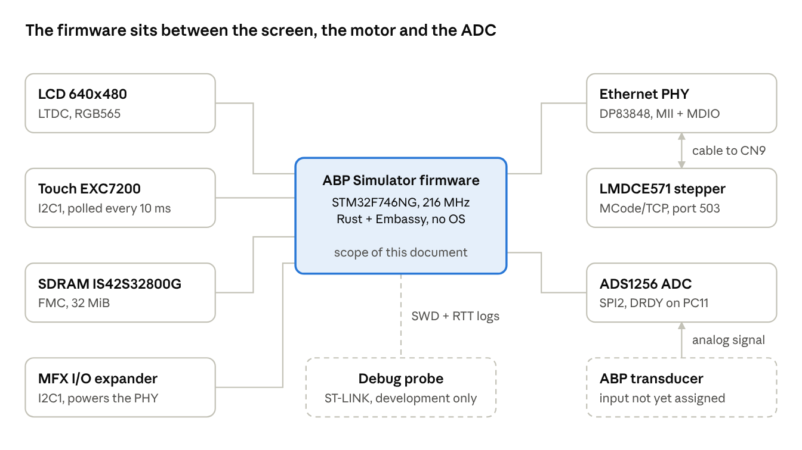
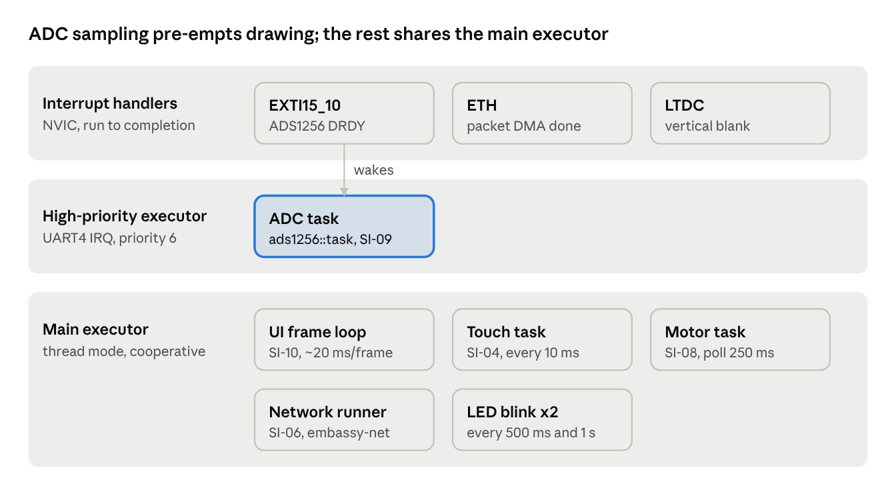
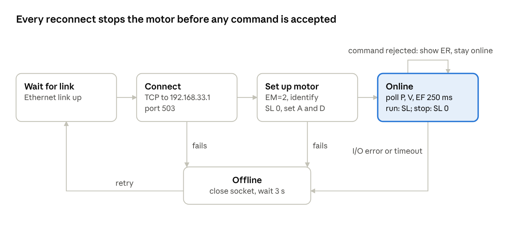

# ABP Simulator – Software Architecture Document (IEC 62304)

2026-11-11 · Germano Farina

This is draft 0.1 of the software architecture for the ABP Simulator firmware, written from the source as of 2026-11-11 and not yet reviewed or approved.

## Document control

| Field | Value |
| --- | --- |
| Document ID | ABP-SAD-001 (proposed) |
| Version | 0.1 (draft) |
| Software | abp-simulator 0.1.0 (Rust, Embassy), STM32F746NG |
| Standard | IEC 62304:2006 + A1:2015, clause 5.3 |

### Revision history

| Version | Date | Change | Author |
| --- | --- | --- | --- |
| 0.1 | 2026-11-11 | First draft from source code | Germano Farina |

### Approvals

| Role | Name | Signature / date |
| --- | --- | --- |
| Author | Germano Farina | |
| Reviewer (software) | | |
| Quality / regulatory | | |

## Purpose and scope

This document records the software architecture of the ABP Simulator firmware as required by IEC 62304 clause 5.3. The ABP Simulator produces arterial blood pressure (ABP) waveforms for testing patient monitors: it drives a pressure source with a stepper motor and reads a pressure transducer through an ADC.

It covers the firmware that runs on the STM32F746NG of the STM32746G-EVAL board. PC tools (LMD Suite, STM32CubeProgrammer, probe-rs) and the motor's own firmware are outside its scope; they appear only as external components.

| IEC 62304 clause | Activity | Section here |
| --- | --- | --- |
| 5.3.1 | Transform requirements into an architecture of software items | Software items |
| 5.3.2 | Interfaces of and between software items | Interfaces |
| 5.3.3 | Functional and performance requirements of SOUP | SOUP items |
| 5.3.4 | System hardware and software required by SOUP | SOUP items |
| 5.3.5 | Segregation needed for risk control | Segregation and risk control |
| 5.3.6 | Verify the architecture | Verification and traceability |

Readers: firmware developers, the software reviewer, and the person responsible for risk management (ISO 14971).

## References and definitions

| Ref | Document |
| --- | --- |
| [R1] | IEC 62304:2006 + A1:2015, Medical device software – Software life cycle processes |
| [R2] | ISO 14971:2019, Application of risk management to medical devices |
| [R3] | UM1902, STM32746G-EVAL user manual (`doc/um1902-…pdf`) |
| [R4] | STM32746G-EVAL schematics MB1167, MB1063, MB1183 (`doc/stm327x6g-eval_sch/`) |
| [R5] | Liberty MDrive 57 mm Ethernet product overview (`doc/IMS-PO-LMDE-57R_A.pdf`) |
| [R6] | LMD Ethernet TCP/IP fieldbus manual, LMD-EIP-REV-F (`doc/LMD-EIP_REV-F.pdf`) |
| [R7] | TI ADS1255/ADS1256 datasheet, SBAS288K (`doc/ads1256.pdf`) |
| [R8] | Software Requirements Specification – not yet written (open item); proposed requirements in [Appendix A](#appendix-a--proposed-software-requirements) |
| [R9] | Risk management file – not yet written (open item) |

| Term | Meaning |
| --- | --- |
| ABP | Arterial blood pressure |
| SOUP | Software of unknown provenance (IEC 62304 3.29): here, third-party Rust crates |
| Software item | Any identifiable part of the software (IEC 62304 3.25); here, a Rust module |
| Task | An Embassy async task, scheduled cooperatively by an executor |
| MCode | Novanta IMS ASCII command language for LMD motors, carried over TCP port 503 |
| RTT / defmt | Real-time transfer over the debug probe / compact logging framework |
| DRDY | ADS1256 "data ready" output, low when a conversion is available |
| MPU | Cortex-M7 memory protection unit |

## Software safety classification

Proposed: **Class B** for the whole software system, until the risk analysis [R9] confirms or changes it. Until then, every item inherits Class B (IEC 62304 4.3 d).

Rationale:

- The simulator is not connected to a patient, so it cannot cause harm directly.
- A wrong pressure waveform or a wrong reading could let a faulty patient monitor pass its test. That monitor could later harm a patient, so a software failure can contribute to a hazardous situation. This rules out Class A unless the risk analysis finds an external control (for example, an independent reference gauge used during every test).
- No failure mode identified so far leads to death or serious injury, so Class C is not proposed.
- The stepper motor is a mechanical hazard to the operator. It is handled by hardware and the motor's own drive, not by this firmware: the firmware's STOP is a normal decelerated stop, not an emergency stop.

The intended use and regulatory status of the simulator (medical device, accessory or test equipment) still need to be confirmed; they decide whether IEC 62304 applies in full.

## System context

The firmware is the only software in scope; everything around it is hardware on the STM32746G-EVAL or connected to it. Dashed parts are not there in normal use: the transducer is not wired yet, and the debug probe is for development only.

## Architecture overview

The firmware is a single Rust binary with no operating system. Embassy runs its tasks on two executors: the ADC task alone on a high-priority interrupt executor, everything else on the cooperative main executor. Within the main executor a task runs until its next `await`, so a long draw delays touch, motor and network work by up to one frame.

Hardware interrupts only wake tasks; the work itself runs in the tasks. ETH wakes the network runner and LTDC wakes the UI loop waiting for the buffer swap.

### Memory layout

| Region | Contents | Cache |
| --- | --- | --- |
| Internal Flash (1 MiB) | Code and constants | Cached, ART accelerator on |
| Internal SRAM (320 KiB) | Stack (below `.data`/`.bss`, flip-link), statics, task state | Cached |
| SDRAM 0xC000_0000, first 1.2 MiB | Two RGB565 framebuffers, 600 KiB each | Non-cacheable (MPU), so LTDC sees every write |
| SDRAM, next | Ethernet DMA packet queue (4 RX + 4 TX) | Non-cacheable, because the Ethernet DMA does no cache maintenance |

## Software items (5.3.1)

The software system splits into 11 software items: one per Rust module in `src/`, plus the waveform generator inside `ui.rs`. None is broken down further, so each is also a software unit for clause 5.4. Their safety class is Class B until the risk analysis says otherwise.

| ID | Software item | Source | Responsibility | Runs in |
| --- | --- | --- | --- | --- |
| SI-01 | Startup and supervisor | `main.rs` | Clock tree (216 MHz), caches, MPU, start-up order, memory layout, spawning tasks, UI frame loop, status LEDs | Main executor |
| SI-02 | SDRAM | `sdram.rs` | FMC set-up of the 32 MiB IS42S32800G; optional memory self-test (`sdram-test` feature) | Start-up only |
| SI-03 | Display | `display.rs` | LTDC set-up for the 640×480 LCD, two RGB565 framebuffers, buffer swap on vertical blank; MPU makes SDRAM non-cacheable | Main executor |
| SI-04 | Touch | `touch.rs` | I2C1 bus, EXC7200 touch controller polled every 10 ms, debounced touch state | Main executor (task) |
| SI-05 | MFX expander | `mfx.rs` | Powers up the Ethernet PHY through the MFX I/O expander | Start-up only |
| SI-06 | Network | `net.rs` | Ethernet MAC over MII, bit-banged MDIO to the DP83848 PHY, link polling, static IPv4 192.168.33.10/16, IP stack runner | Main executor (task) |
| SI-07 | MCode client | `mcode.rs` | TCP connection to the motor on port 503, echo mode set-up, command / query / set with acceptance and read-back checks | Called by SI-08 |
| SI-08 | Motor control | `motor.rs` | Motor connection state, start-up stop, accel/decel, run and stop commands, 250 ms status polling, error reporting | Main executor (task) |
| SI-09 | ADC driver | `ads1256.rs` | ADS1256 on SPI2: probe, configuration, self-calibration, reading each conversion, rate measurement | High-priority executor (task) |
| SI-10 | User interface | `ui.rs` | Monitor, Motor Test and ADC tabs: drawing, touch handling, sending commands to SI-08 and SI-09 | Main executor (frame loop) |
| SI-11 | Placeholder waveform | `ui.rs` (`pressure`) | Generates the displayed ABP shape; not yet a physiological model | Main executor |

SI-11 lives inside `ui.rs` today. It will become its own module once the waveform model drives the motor, because it is the item most likely to carry risk.

## Interfaces (5.3.2)

Software items talk to each other only through three kinds of interface: a published state snapshot, a one-slot command signal, and plain function calls at start-up. No item writes another item's memory.

### Between software items

| ID | From → to | Mechanism | Data | Notes |
| --- | --- | --- | --- | --- |
| IF-01 | SI-04 → SI-10 | `touch::current()`: snapshot in a critical-section mutex | Touch point (pixels and raw) or none | Read once per frame |
| IF-02 | SI-10 → SI-08 | `motor::command()`: one-slot `Signal` | `Run { rpm }` or `Stop` | Ignored while the motor is offline; only the latest command counts |
| IF-03 | SI-08 → SI-10 | `motor::view()`: snapshot in a critical-section mutex | Connected, commanded rpm, measured rpm, position, last error code | Updated every 250 ms and after each command |
| IF-04 | SI-10 → SI-09 | `ads1256::configure()`: one-slot `Signal` | Inputs, gain, data rate, buffer | Only the latest counts; triggers self-calibration |
| IF-05 | SI-09 → SI-10 | `ads1256::view()`: snapshot in a critical-section mutex | Status, applied settings, last code and µV, measured samples/s | Updated on every conversion |
| IF-06 | SI-08 → SI-07 | Function calls on `mcode::Client` | MCode commands and replies | Errors returned as `mcode::Error` |
| IF-07 | SI-06 → SI-08 | `embassy_net::Stack` handle | TCP sockets, link state | |
| IF-08 | SI-01 → SI-02, 03, 05, 06, 09 | Init functions, ownership of peripherals | Pins, buffers in SDRAM | Each peripheral is owned by exactly one item (Rust ownership) |

### With hardware and external components

| ID | Item | External component | Interface | Key parameters |
| --- | --- | --- | --- | --- |
| IF-10 | SI-06, SI-07 | Novanta LMDCE571 stepper motor | Ethernet 100 Mbit/s, TCP 192.168.33.1:503, MCode ASCII ended by CR | EM=2 forced on connect; 1 s reply timeout; 10 s socket timeout |
| IF-11 | SI-09 | TI ADS1256 ADC | SPI2 mode 1 at 1.69 MHz; CS PA4, DRDY PC11 (EXTI) | 7.68 MHz clock, VREF 2.5 V, 2.5 to 7500 samples/s |
| IF-12 | SI-04, SI-05 | EXC7200 touch controller, MFX expander | I2C1 at 100 kHz (PB8/PB9), addresses 0x04 and 0x42 | |
| IF-13 | SI-06 | DP83848 PHY | MII data, MDIO bit-banged on PG6/PG7 | Link polled every 500 ms |
| IF-14 | SI-03 | Ampire 640×480 LCD | LTDC parallel RGB, 25.17 MHz pixel clock | RGB565 framebuffers |
| IF-15 | SI-02 | IS42S32800G SDRAM | FMC bank 1 at 0xC000_0000 | 32 MiB |
| IF-16 | All | Debug probe (ST-LINK) | SWD + defmt logs over RTT | Development only; see the RTT note under risk control |

## SOUP items (5.3.3, 5.3.4)

The firmware declares 15 SOUP crates directly; the table adds smoltcp (the TCP/IP stack inside embassy-net) and the flip-link linker. All are pinned by `Cargo.lock`. The other transitive dependencies are SOUP too and must be listed from `Cargo.lock` before release. Every SOUP runs on the same STM32F746NG with no operating system, built with the stable Rust toolchain for `thumbv7em-none-eabihf`.

| SOUP | Version | Used by | Functional requirement on it | Performance requirement on it |
| --- | --- | --- | --- | --- |
| embassy-stm32 | 0.6.0 | SI-01 to SI-06, SI-09 | Correct drivers for RCC, GPIO, EXTI, SPI, I2C, FMC, LTDC, ETH, MPU set-up | SPI2 ≤ 1.92 MHz; EXTI wake-up within one conversion period |
| embassy-executor | 0.10.0 | All tasks | Cooperative thread executor and interrupt executor; tasks run to their next await | High-priority executor pre-empts the main one |
| embassy-time | 0.5.1 | All tasks | Monotonic time, timers, timeouts | 1 ms resolution or better |
| embassy-sync | 0.8.0 | IF-01 to IF-05 | Critical-section mutex and `Signal` safe across executors | |
| embassy-futures | 0.1.2 | SI-08, SI-09 | `select` of two futures | |
| embassy-net | 0.9.1 | SI-06, SI-07 | Static IPv4, TCP client sockets, ICMP echo | Reply to motor within the 1 s MCode timeout |
| smoltcp | 0.13.1 (via embassy-net) | SI-06 | TCP/IP protocol stack | |
| embedded-graphics | 0.8.2 | SI-03, SI-10 | Primitives and text into the framebuffer | Frame drawn in < 33 ms (measured 19.6 ms) |
| libm | 0.2.16 | SI-11 | `expf`, `fmodf` | |
| stm32-fmc | 0.4.0 | SI-02 | SDRAM timing data for IS42S32800G | |
| cortex-m | 0.7.10 | SI-01, SI-09 | Cache control, busy-wait delays, critical sections | Delay accurate to one core cycle count |
| cortex-m-rt | 0.7.7 | SI-01 | Reset handler, vector table, interrupt attribute | |
| defmt / defmt-rtt | 1.2.0 / 1.3.1 | All | Logging over RTT | Non-blocking when no probe is attached |
| panic-probe | 1.0.0 | All | Halts and reports on panic | |
| static_cell | 2.1.1 | SI-06 | One-time static allocation | |
| flip-link | (linker, host tool) | Build | Places the stack below `.data`/`.bss` so overflow faults | |

Hardware and software required by SOUP (5.3.4): Cortex-M7 with FPU, 216 MHz core clock, 25 MHz HSE crystal, external SDRAM for framebuffers and Ethernet DMA buffers, and the stable Rust compiler pinned in `rust-toolchain.toml`.

The SOUP list must be kept as a separate controlled record with each item's known anomalies (IEC 62304 7.1.3); that review is an open item.

## Dynamic behaviour

### Start-up sequence

1. Clocks to 216 MHz, caches and Flash accelerator on (SI-01).
2. SDRAM initialised; MPU marks it non-cacheable (SI-02, SI-03).
3. Framebuffers and Ethernet queue placed in SDRAM; LTDC started (SI-03).
4. I2C1 bus scanned, PHY powered through the MFX, touch task started (SI-04, SI-05).
5. Ethernet and IP stack started (SI-06), then the motor task (SI-08).
6. ADS1256 SPI, CS and DRDY set up; interrupt executor started at priority 6 and the ADC task spawned on it (SI-09).
7. LED blink tasks started; the main loop draws frames forever (SI-10).

### Motor connection

UI commands are only accepted while the task is Online; commands sent while offline are dropped, so the motor never acts on a stale command after reconnecting.

### ADC sampling

The ADC task probes the chip (reset, then the ID in STATUS) and retries every 2 s while it is missing. Once found, it writes the settings, runs self-calibration and then reads one result each time DRDY falls. A settings change from the UI interrupts the loop and goes back to writing settings. A missed DRDY (4 conversion periods, at least 50 ms) sends it back to probing.

### Timing

| Activity | Period or budget | Source |
| --- | --- | --- |
| UI frame | 33 ms (30 frames/s); draw measured at 19.6 ms max | Log, 2026-11-11 |
| Touch poll | 10 ms; release after 50 ms without data | `touch.rs` |
| Motor status poll | 250 ms | `motor.rs` |
| Motor reply timeout | 1 s per query; 10 s socket inactivity | `mcode.rs` |
| Motor reconnect delay | 3 s | `motor.rs` |
| PHY link poll | 500 ms | `net.rs` |
| ADC conversion | 0.13 ms to 400 ms (7500 to 2.5 samples/s); ~30 µs CPU per sample | `ads1256.rs` (estimate, not measured) |

## Segregation and risk control (5.3.5)

The firmware runs as one image in one address space, so there is no hardware segregation between items; all items share the system's Class B. The measures below limit how far a fault in one item can spread.

| ID | Measure | Protects against | Where |
| --- | --- | --- | --- |
| RC-01 | Rust memory safety: `unsafe` code only in 10 places (SDRAM mapping and self-test, MPU set-up, memory layout, Ethernet queue, cache set-up, executor interrupt), all in start-up or hardware set-up; each needs a written SAFETY argument, checked in review | Memory corruption between items | All items |
| RC-02 | Peripheral ownership: each peripheral and pin is moved to exactly one item at start-up | Two items driving the same hardware | SI-01 |
| RC-03 | Stack overflow faults instead of corrupting data (flip-link places the stack below `.data`/`.bss`) | Silent corruption on stack overflow | Build |
| RC-04 | Priority separation: ADC sampling on the interrupt executor (UART4, priority 6), above drawing and networking | Missed conversions while a frame is drawn (~20 ms) | SI-01, SI-09 |
| RC-05 | ADC rate capped at 7500 samples/s; 15k and 30k left out | Sampling starving the UI and touch, which would lock out the operator | SI-09, SI-10 |
| RC-06 | Motor stopped (`SL 0`) and accel/decel set on every (re)connect; commands made while offline are dropped | Motor starting with stale settings or commands | SI-08 |
| RC-07 | Every MCode write checked through the error flag, every `set` read back | Motor silently ignoring a command | SI-07 |
| RC-08 | Echo mode forced to EM=2 on connect | Replies read out of step, wrong values shown | SI-07 |
| RC-09 | Timeouts on every external interface (MCode reply 1 s, socket 10 s, DRDY 4 periods, self-calibration 1.5 s), followed by reconnect or re-probe | A hung peripheral freezing a task | SI-07, SI-08, SI-09 |
| RC-10 | Settings written to the motor stay in RAM; nothing is saved to its non-volatile memory | Leaving the motor in a changed state after a power cycle | SI-07 |

Known limitations to bring into the risk analysis:

- STOP is a decelerated stop over the network, not an emergency stop. A hardware emergency stop is needed if the risk analysis calls for one.
- If the network fails while the motor is running, the motor keeps its last speed; the firmware cannot stop it until it reconnects.
- After a debugger session ends abruptly, defmt can stay in blocking mode and freeze the firmware once the log buffer fills; a reset clears it. Release builds should use non-blocking logging or no RTT at all.
- There is no watchdog yet.

## Verification and traceability (5.3.6)

The architecture cannot be fully verified yet: the software requirements [R8] and the risk analysis [R9] it must trace to do not exist. The checks below are what clause 5.3.6 asks for, with what can be shown today.

A first set of requirements to trace against, with their coverage by this architecture, is in [Appendix A](#appendix-a--proposed-software-requirements).

| Check (5.3.6) | Evidence today | Status |
| --- | --- | --- |
| a) Architecture implements system and software requirements | Items and interfaces match the source (`src/`, 2026-11-11) | Open: no requirements to trace to |
| b) Architecture supports the interfaces between items and between items and hardware | Interface tables above; firmware built and run on the board with motor connected, run and stop at 10 rpm checked on 2026-11-11 | Partly done; ADC (IF-11) built, not yet tested on hardware |
| c) Architecture supports proper operation of SOUP | SOUP table with requirements per crate | Open: anomaly lists not reviewed |
| d) Segregation supports risk control | Risk control table above | Open: needs the risk analysis |

### Open items

- [ ] Confirm intended use, regulatory status and software safety class
- [ ] Write the Software Requirements Specification and add a requirement → software item trace table
- [ ] Write the risk analysis; link each RC measure to a hazard
- [ ] Review SOUP anomaly lists and list transitive dependencies from `Cargo.lock`
- [ ] Decide on a watchdog and on what happens to the motor when the network drops
- [ ] Move the waveform generator (SI-11) out of `ui.rs` once it drives the motor
- [ ] Test the ADS1256 driver on hardware and map the ABP transducer input
- [ ] Review and approve this document

---

## Appendix A – Proposed software requirements

I propose 37 requirements: the architecture covers 16, covers 9 in part, and has nothing yet for 12. Most gaps are in pressure control, calibration and fail-safe behaviour, the parts most likely to carry risk.

These are drafts for the Software Requirements Specification [R8]: values marked "to be set" need a decision. Each row traces to the software items (SI) and to the interfaces (IF) and risk controls (RC) above. Coverage describes the current code: Implemented means the code does it, not that it has been verified.

### Motor control

| ID | Requirement | Software items | Architecture | Verification | Coverage |
| --- | --- | --- | --- | --- | --- |
| SRS-MOT-01 | The software shall connect to the motor at 192.168.33.1, TCP port 503, using MCode, and show whether the motor is online. | SI-06, SI-07, SI-08, SI-10 | IF-03, IF-07, IF-10 | Test on hardware | Implemented |
| SRS-MOT-02 | On every connection, before accepting a command, the software shall stop the motor and set acceleration and deceleration to 5 rev/s². | SI-08 | RC-06 | Test, log review | Implemented |
| SRS-MOT-03 | The software shall run the motor continuously at an operator-set speed of 10 to 300 rpm, in 10 rpm steps. | SI-08, SI-10 | IF-02 | Test on hardware | Implemented |
| SRS-MOT-04 | On STOP, the software shall bring the motor to standstill with the set deceleration. | SI-08 | IF-02 | Test on hardware | Implemented |
| SRS-MOT-05 | The software shall discard motor commands made while the motor is offline. | SI-08, SI-10 | IF-02, RC-06 | Test | Implemented |
| SRS-MOT-06 | The software shall detect a lost motor connection within 10 s and retry every 3 s. | SI-07, SI-08 | RC-09 | Test (unplug cable) | Implemented |
| SRS-MOT-07 | The software shall confirm that the motor accepted each command and that each value written reads back unchanged. | SI-07 | RC-07 | Unit test, test | Implemented |
| SRS-MOT-08 | The software shall show the last motor error code (ER) on the Motor Test screen. | SI-08, SI-10 | IF-03 | Test | Implemented |
| SRS-MOT-09 | The software shall not write to the motor's non-volatile memory. | SI-07 | RC-10 | Code review | Implemented |
| SRS-MOT-10 | The motor shall stop within a time to be set (proposed 1 s) when communication with the controller is lost. | SI-08, motor program | None yet | Test (unplug cable while running) | Gap |

### Pressure acquisition

The ADC items are built but not yet tested on hardware, so none is marked Implemented.

| ID | Requirement | Software items | Architecture | Verification | Coverage |
| --- | --- | --- | --- | --- | --- |
| SRS-ADC-01 | The software shall read every ADS1256 conversion at data rates from 2.5 to 7500 samples/s, including while the screen is being drawn. | SI-09 | RC-04, IF-11 | Test: measured rate equals set rate | Partial |
| SRS-ADC-02 | The operator shall be able to select the positive input (AIN0–7), negative input (AIN0–7, AINCOM), gain (1–64), data rate and input buffer. | SI-09, SI-10 | IF-04 | Test | Partial |
| SRS-ADC-03 | The software shall self-calibrate the ADC after every settings change and at start-up. | SI-09 | IF-04 | Test, log review | Partial |
| SRS-ADC-04 | The software shall detect a missing ADC or a missing DRDY within 2 s and show it on the ADC screen. | SI-09, SI-10 | IF-05, RC-09 | Test (ADC unplugged) | Partial |
| SRS-ADC-05 | The software shall convert each result to microvolts as code × 2 × VREF / (gain × 2²³), with VREF = 2.5 V. | SI-09 | IF-05 | Unit test | Partial |
| SRS-ADC-06 | The software shall convert the transducer signal to mmHg using a stored sensitivity and zero offset. | New item (calibration) | None yet | Test against a reference gauge | Gap |
| SRS-ADC-07 | The operator shall be able to zero the pressure reading with the transducer open to air. | New item (calibration), SI-10 | None yet | Test | Gap |
| SRS-ADC-08 | Measured pressure shall be accurate to ±X mmHg over 0 to 300 mmHg (X to be set from the monitor test standard). | SI-09, calibration | None yet | Test against a reference gauge | Gap |

### Waveform generation and display

| ID | Requirement | Software items | Architecture | Verification | Coverage |
| --- | --- | --- | --- | --- | --- |
| SRS-WAV-01 | The software shall generate an ABP waveform from an operator-set heart rate, systolic and diastolic pressure. | SI-11 | Placeholder shape in `ui.rs`, fixed at 72 bpm, 120/80 mmHg | Unit test of the shape | Partial |
| SRS-WAV-02 | The operator shall be able to set heart rate (range to be defined, e.g. 30–240 bpm) and systolic/diastolic pressure (e.g. 0–300 mmHg). | SI-10, SI-11 | None yet | Test | Gap |
| SRS-WAV-03 | The software shall drive the motor so that the measured pressure follows the generated waveform within a tolerance to be set. | SI-08, SI-09, SI-11, new control item | None yet: needs a control loop between ADC and motor | Test against a reference gauge | Gap |
| SRS-WAV-04 | The Monitor screen shall show the pressure trace on a 0–200 mmHg scale with HR, SYS/DIA and MAP readouts. | SI-10 | IF-01 | Test | Partial |
| SRS-WAV-05 | The Monitor screen shall show the measured pressure, not only the generated one. | SI-09, SI-10 | IF-05 | Test | Gap |
| SRS-WAV-06 | The software shall compute MAP as DIA + (SYS − DIA) / 3, or from the measured waveform (to be decided). | SI-10, SI-11 | First formula used in `ui.rs` on the placeholder values | Unit test | Partial |

### User interface

| ID | Requirement | Software items | Architecture | Verification | Coverage |
| --- | --- | --- | --- | --- | --- |
| SRS-UI-01 | The software shall provide a 640×480 touch screen with three tabs: Monitor, Motor Test and ADC. | SI-03, SI-04, SI-10 | IF-01, IF-12, IF-14 | Test | Implemented |
| SRS-UI-02 | The screen shall refresh at least 25 times per second. | SI-03, SI-10 | Main executor, frame loop | Test: fps in log (30 measured) | Implemented |
| SRS-UI-03 | The software shall react to a touch within 100 ms. | SI-04, SI-10 | 10 ms poll + one frame | Test | Implemented |
| SRS-UI-04 | START and STOP shall be disabled and shown greyed out while the motor is offline. | SI-10 | IF-03 | Test | Implemented |
| SRS-UI-05 | Operator settings (speed, ADC settings, waveform) shall be kept across a power cycle. | SI-10, new storage item | None yet: settings are RAM only | Test | Gap |

### Platform, robustness and safety

Rows marked as risk control candidates should be confirmed or dropped by the risk analysis [R9].

| ID | Requirement | Software items | Architecture | Verification | Coverage |
| --- | --- | --- | --- | --- | --- |
| SRS-PLT-01 | The software shall use the static address 192.168.33.10/16 and answer ICMP echo (ping). | SI-06 | IF-07, IF-13 | Test | Implemented |
| SRS-PLT-02 | A stack overflow shall stop the software with a fault rather than corrupt data. | SI-01, build | RC-03 | Test (forced overflow) | Implemented |
| SRS-PLT-03 | Each peripheral shall be controlled by exactly one software item. | SI-01 | RC-02 | Code review | Implemented |
| SRS-PLT-04 | A watchdog shall reset the software if the main loop or the ADC task stops running for more than a time to be set. Risk control candidate. | SI-01, new watchdog item | None yet | Test (forced hang) | Gap |
| SRS-PLT-05 | After any reset or fault, the motor shall be stopped before normal operation resumes. Risk control candidate. | SI-08 | RC-06 covers reconnect only; a reset does not stop a running motor | Test (reset while running) | Gap |
| SRS-PLT-06 | The software shall stop the motor if measured pressure exceeds a maximum (proposed 300 mmHg). Risk control candidate. | SI-08, SI-09, new item | None yet | Test with simulated over-pressure | Gap |
| SRS-PLT-07 | Release builds shall never block on logging when no debugger is attached. | SI-01, build | RC known limitation (RTT) | Test: run 24 h without probe | Gap |
| SRS-PLT-08 | The software shall be ready for use within 5 s of power-on (to be confirmed by measurement). | SI-01 to SI-09 | Start-up sequence | Test | Partial |

### Gaps in the architecture

The 12 Gap rows need 7 changes to the architecture. The first two carry the risk control candidates, so they come first.

| Change | Requirements | Proposed architecture change |
| --- | --- | --- |
| Pressure control item | SRS-WAV-03, SRS-WAV-05, SRS-PLT-06 | New software item between SI-09 and SI-08: reads each pressure sample, computes the motor command, stops the motor on over-pressure. Runs on the high-priority executor, next to the ADC task. |
| Motor fail-safe | SRS-MOT-10, SRS-PLT-05 | Stop the motor on start-up of SI-08 before anything else, and check whether the LMD supports a communication-loss stop (MCode manual); if not, a hardware stop is needed. |
| Calibration item | SRS-ADC-06, SRS-ADC-07, SRS-ADC-08 | New software item: mmHg from µV with sensitivity and zero, a zero command from the UI, values kept in storage. |
| Waveform settings | SRS-WAV-02 | Extend SI-10 with HR, SYS and DIA settings, passed to SI-11 the same way as the motor and ADC settings. |
| Non-volatile storage | SRS-UI-05, calibration values | New software item on the internal Flash or the board's EEPROM, with a checksum and defaults when the data is invalid. |
| Watchdog | SRS-PLT-04 | Independent watchdog fed only when both the main loop and the ADC task have run recently. |
| Release logging | SRS-PLT-07 | Non-blocking RTT mode or no RTT in release builds; a build feature in SI-01. |
